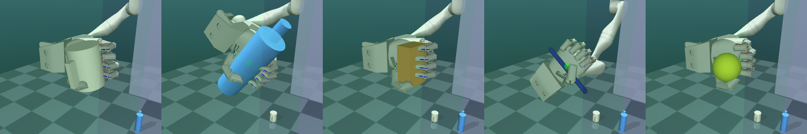
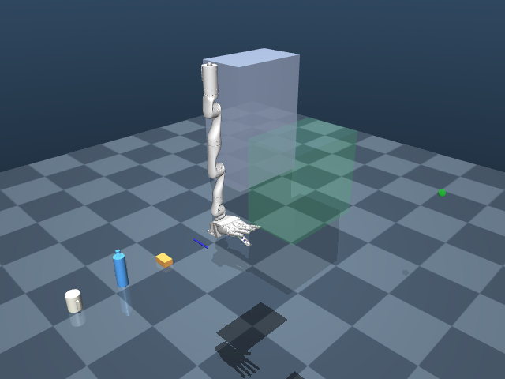

# Prosthetic Arm × TabPFN

**How far can a table take a prosthetic arm?**
A simulated robot arm and hand for someone who has lost an arm at the shoulder. It sees an object being handed over, **TabPFN-3.5 predicts what it is, where it will stop and whether the grasp will hold**, and a reinforcement-learning agent reaches and grasps it, only after the user says “ready”.

Built at **HackLab Berlin × TabPFN** (Prior Labs track) by **The Big Gang**: Minh Nguyen, Quan Vo, Kazuki Dozono.

| Real-physics grasps, no assist | The arm at human scale |
|---|---|
|  |  |

---

## What it does

1. **Ready:** nothing moves until the user says “ready” (browser speech recognition, with buttons as a fallback). “Stop” freezes every joint; “release” opens the hand.
2. **Detect:** an object counts as detected within 50 cm of the hand while moving toward it.
3. **What is it?** TabPFN classifies the object (cup, bottle, box, pen, ball) from five noisy shape features.
4. **Where is it going?** From one look at detection (position and velocity), TabPFN predicts where the object will stop, with a 10–90% range. A pink marker shows the prediction in the 3D view.
5. **Reach and grasp:** a PPO agent moves the hand, turns the wrist to suit the object and closes the grip. It acts on **TabPFN’s predicted stop point, never the simulator’s true one**.
6. **What happens next?** The moment the fingers touch, TabPFN predicts the chance that the grasp ends in a stable hold.

Every robot step, detection and grasp is a row in a table, and TabPFN learns from past rows in context, with no training run.

## Results

All numbers are on held-out data that the models never saw (fixed evaluation seeds for the agent).

**TabPFN predictions**

| Question | TabPFN-3.5 | Baselines | Held-out set |
|---|---|---|---|
| What is it? | **100%** accuracy | hand-written rule 98.3% | 600 episodes |
| Where will it stop? | **2.6 cm** median error, 6.0 cm at the 90th percentile; 10–90% range covers 79% | linear regression 2.7 / 6.6 cm; geometry 4.5 / 11.1 cm | 750 approaches |
| Will the grasp hold? | **ROC AUC 0.977**, Brier 0.047, accuracy 0.923 | logistic regression 0.863 / 0.106 / 0.846; wrist-angle rule 0.583 / 0.144 / 0.856 | 599 grasps |

A note on the stop point: with our engineered “arm’s length” feature, linear regression comes close in the median. TabPFN’s edge there is the bad cases and a calibrated uncertainty range. The hold prediction is well calibrated at the ends (says 96% → 98% held; says 4% → 0% held) and somewhat over-confident in the middle (says 71% → 54% held).

**The arm** (grasp success, 200 held-out episodes, real contact physics, no grasp assist)

| Controller | Success |
|---|---|
| Scripted expert (knows the hand-over pose) | 87.5% (35/40) |
| Agent imitating the expert | 64% |
| **Agent after 1M PPO steps, acting on TabPFN’s stop point** | **82%** (pen 32/43) |
| Same agent given the simulator’s true stop point (reference) | 86% |

Live predictions take about **0.1 s on a laptop CPU** (fast TabPFN checkpoint with a cached context).

## The simulator

- **MuJoCo** with real robot models from **[MuJoCo Menagerie](https://github.com/google-deepmind/mujoco_menagerie)**, attached in code (`sim/build.py`):
  - **Kinova Gen3** arm, 7 joints, scaled to 60% so shoulder-to-wrist is about 0.7 m like a human arm, hanging from the shoulder.
  - **TetherIA Aero Hand Open**, a tendon-driven humanoid hand (0.45 kg), closed as one prosthetic-style power-grip synergy, with the tendon motors capped at 40 N.
  - An IMU (accelerometer + gyro) in the thumb.
- **Actions** (5): hand velocity x/y/z, wrist turn rate, grip rate. Damped-least-squares inverse kinematics (`sim/ik.py`) turns them into the 7 joint targets.
- **Hand-over:** an invisible carrier brings the object along a straight line to a point at about arm’s length from the shoulder, and lets go once the hand has closed on it.
- **Grasps are physical:** objects are held by contact forces only.

## Quick start

Tested on Windows 11, CPU only, with Python 3.14, MuJoCo 4.0.1, Stable-Baselines3 2.9.2, Gymnasium 1.4.0 and TabPFN 10.2.0.

```bash
pip install -r requirements.txt
```

TabPFN downloads its model weights on first use and may ask you to accept its licence.

**Run the web app** (live simulation, voice commands, results, CSV upload):

```bash
python -m uvicorn server:app --port 8000
```

Open http://localhost:8000, press **New episode**, then **Ready** (or 🎤 Voice and say “ready”). Start it about a minute before a demo: the three TabPFN models load in the background (the header shows “TabPFN ready”). The page works offline. If the live demo fails, `demo_replays/` has five recorded episodes.

**Self-checks**

```bash
python sim/build.py        # builds the model, renders sim/preview.png
python sim/ik.py           # inverse kinematics reaches the handshake pose
python -m sim.env          # Gymnasium API check, random episode, expert success, speed
```

**Evaluate the agent**

```bash
python train.py --eval models/ppo_arm.zip --episodes 200 --tabpfn-goal   # acting on TabPFN's stop point
python train.py --eval models/ppo_arm.zip --episodes 200                 # given the true stop point
```

**TabPFN experiments**

```bash
python classifier.py                    # object ID vs the rule
python trajectory.py --collect 3000     # log approaches at detection -> data/trajectory.csv
python trajectory.py                    # stop-point prediction vs baselines (saves the error vectors)
python grasp_outcome.py --collect 2400  # log grasps at first touch -> data/grasp_touch.csv
python grasp_outcome.py                 # hold prediction vs baselines, with calibration
python tabpfn_generate.py --n 500       # TabPFN synthetic shape data, train-on-synthetic / test-on-real
```

**Train the agent** (imitation of the scripted expert, then PPO; about 30 minutes with 12 processes)

```bash
python train.py --bc 300 --steps 1000000 --envs 12 --goal-noise data/trajectory_residuals.npy --out models/v2/ppo_arm
```

`--goal-noise` adds TabPFN’s real held-out stop-point errors during training, so the agent learns to act on predictions. Copy the result to `models/ppo_arm.zip` for the web app.

**Record demo videos**

```bash
python record_demo.py --n 5 --rl
```

## Project layout

| Path | What it is |
|---|---|
| `sim/scene.xml`, `sim/objects.xml` | Floor, torso, camera, the five objects and the hand-over carrier |
| `sim/build.py` | Loads the Menagerie arm and hand, scales and attaches them, adds the IMU, grip synergy |
| `sim/ik.py` | Inverse kinematics for the hand |
| `sim/env.py` | Gymnasium environment: hand-over, voice timeline, detection, rewards, scripted expert, TabPFN hooks |
| `sim/menagerie/` | Kinova Gen3 and TetherIA Aero Hand Open models, with their licences |
| `trajectory.py` | TabPFN: where the object will stop |
| `grasp_outcome.py` | TabPFN: will the grasp hold |
| `classifier.py` | TabPFN: which object |
| `tabpfn_generate.py` | TabPFN synthetic data for the shape features |
| `train.py` | Imitation + PPO training and evaluation |
| `server.py`, `index.html`, `static/` | Web app (FastAPI + one page, Chart.js served locally) |
| `record_demo.py` | Records MP4 replays with the predicted-stop marker |
| `generate_dataset.py` | Shared constants, reward weights and the object rule |
| `models/ppo_arm.zip` | The trained agent used by the web app (`models/v2/` has the full run) |
| `data/` | Logged rows for the TabPFN models |

## Limitations

- The hand-over is scripted: a straight-line carrier that lets go once the hand has closed.
- Sensing is simulated: object pose and noisy shape features come from MuJoCo, not a camera.
- The 7-joint arm’s elbow sometimes swings out sideways, and the grip force spikes briefly as the fingers close.
- `data/run1_*` and the per-step dataset generator in `generate_dataset.py` come from our first, homemade simulator. The object classifier still uses `data/run1_features.csv`, but the generator needs porting to `sim/` before it can produce new per-step datasets. `data/run1_steps.csv` (173 MB) is not in the repo.

## Credits and licences

- **TabPFN** by [Prior Labs](https://priorlabs.ai): tabular foundation model, used through the `tabpfn` and `tabpfn-extensions` packages.
- **[MuJoCo](https://mujoco.org)** and **[MuJoCo Menagerie](https://github.com/google-deepmind/mujoco_menagerie)** (Google DeepMind). The Kinova Gen3 model is © Kinova inc. under its BSD-style licence; the TetherIA Aero Hand Open model is under Apache-2.0. Both licence files are in `sim/menagerie/`.
- **[Stable-Baselines3](https://github.com/DLR-RM/stable-baselines3)** (PPO), **[Gymnasium](https://gymnasium.farama.org)**, **FastAPI**, **Chart.js**.
